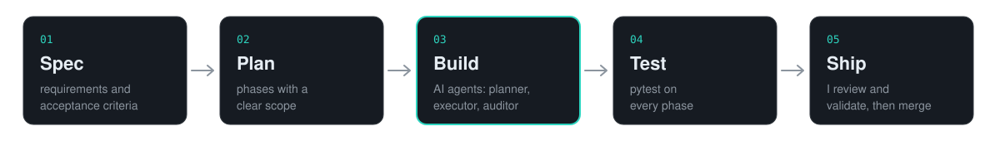

<picture>
  <source media="(prefers-color-scheme: dark)" srcset="assets/header-dark.svg" />
  <source media="(prefers-color-scheme: light)" srcset="assets/header-light.svg" />
  
</picture>

I'm an Information Technology engineering student in Mexico who likes the whole path from **raw data to a decision**: pulling it from APIs and CSVs, modeling it in SQL, building the app around it and proving it works with tests.

I'm looking for a **Data Analyst or Software Developer internship in the U.S. (Sep–Dec 2027, J-1 program)**.

[LinkedIn](https://www.linkedin.com/in/%C3%A1ngel-andr%C3%A9s-valencia-contreras-726799400) · [Medium](https://medium.com/@angelandresvalenciaga.00) · [Email](mailto:angelandresvalenciaga.00@gmail.com)

---

## Selected work

### 📡 [ISP Coverage & Sales Portal](https://github.com/angel-valencia-c/isp-coverage-portal)
A regional internet provider was answering every "is there coverage at my address?" by phone. With a team of 3, we built a portal where customers check coverage, compare plans and request installation, and staff manage the leads.

- Admin panel with **3 roles**, lead notes, **duplicate detection** (same phone within 7 days) and filtered **CSV export**
- **Demand analytics** by municipality, community and covered vs. uncovered zones, to show where to expand next
- **220 automated tests (pytest), all passing, 77% coverage**

`Flask 3` `SQLAlchemy` `Alembic` `MySQL` `Flask-Login` · client project, team of 3

### 🎮 [ARC Raiders Loot Analysis](https://github.com/angel-valencia-c/arc-raiders-loot-analysis)
Which enemies drop the most valuable loot, and where? The Kaggle data hid its relationships in JSON strings inside CSV columns.

- ETL that flattens nested JSON into a **normalized 7-table SQLite schema** (1,021 rows)
- SQL joins + **5 seaborn/matplotlib charts**. Finding: *Queen* is worth **27,340** in loot, but only on 3 of the 6 maps
- 7 unit tests with GitHub Actions CI

`pandas` `SQLite` `Jupyter` `seaborn` `pytest`

### 🔗 [URL Shortener Analytics](https://github.com/angel-valencia-c/url-shortener-analytics)
A link shortener built for marketing: every click is logged **before** the 302 redirect, so you know which campaign actually works.

- Captures UTM tags and ad click IDs (Google, Meta, TikTok, Microsoft), plus device and browser parsed from the User-Agent
- Password-protected dashboard with Chart.js trends, link editing, on/off switch and **Excel/CSV reports**

`Flask` `SQLite` `Chart.js` `openpyxl`

### ⚽ Football Match Predictor private · in progress
Predicts match outcomes from historical results pulled from two sports-data REST APIs.

- ETL with rate-limit handling and upserts into SQLite
- Poisson goal model with time-decayed form, opponent-strength weighting and head-to-head history
- **Next:** a leak-free backtest scored with Brier score against a baseline

`SciPy` `SQLAlchemy` `REST APIs`

---

## How I work

<picture>
  <source media="(prefers-color-scheme: dark)" srcset="assets/workflow-dark.svg" />
  <source media="(prefers-color-scheme: light)" srcset="assets/workflow-light.svg" />
  
</picture>

I build with **AI coding agents**, and I own the result. I write the spec and acceptance criteria, split the work into phases, delegate implementation to planner/executor/auditor agents, and nothing ships until the tests pass and I've reviewed it.

## Toolbox

| | |
|---|---|
| **Data** | Python · pandas · SQL (MySQL, SQLite) · Jupyter · matplotlib · seaborn · SciPy |
| **Backend** | Flask · SQLAlchemy · Alembic · REST APIs · PHP |
| **Frontend** | HTML · CSS · JavaScript · Chart.js |
| **Quality & tools** | pytest · GitHub Actions · Git · Linux (Arch / CachyOS) |

## Right now

- 🧪 Making the football model's backtest honest: only past matches, Brier score vs. baseline
- 🎓 7th term, B.Eng. in IT & Digital Innovation (UTCGG), with an associate degree (TSU) in Multiplatform Software Development
- ✍️ Writing about what I learn on [Medium](https://medium.com/@angelandresvalenciaga.00)
